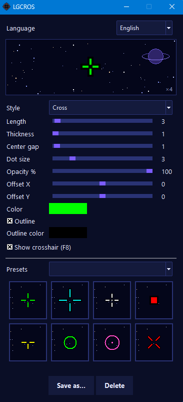
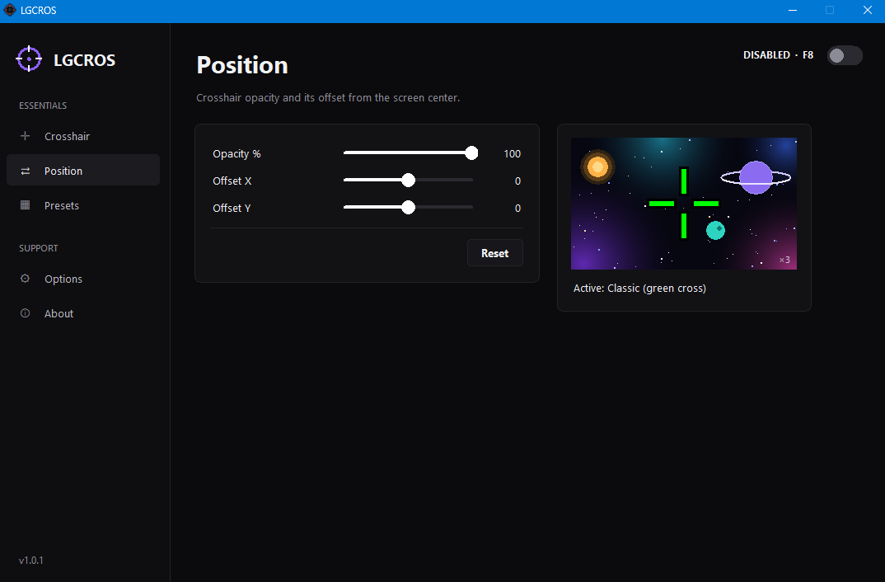
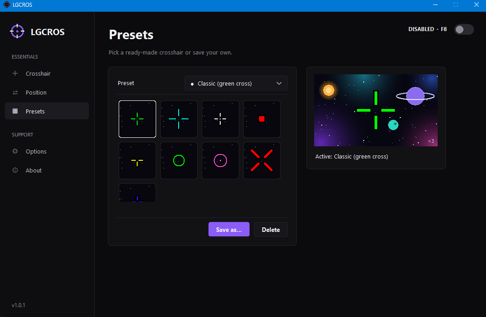
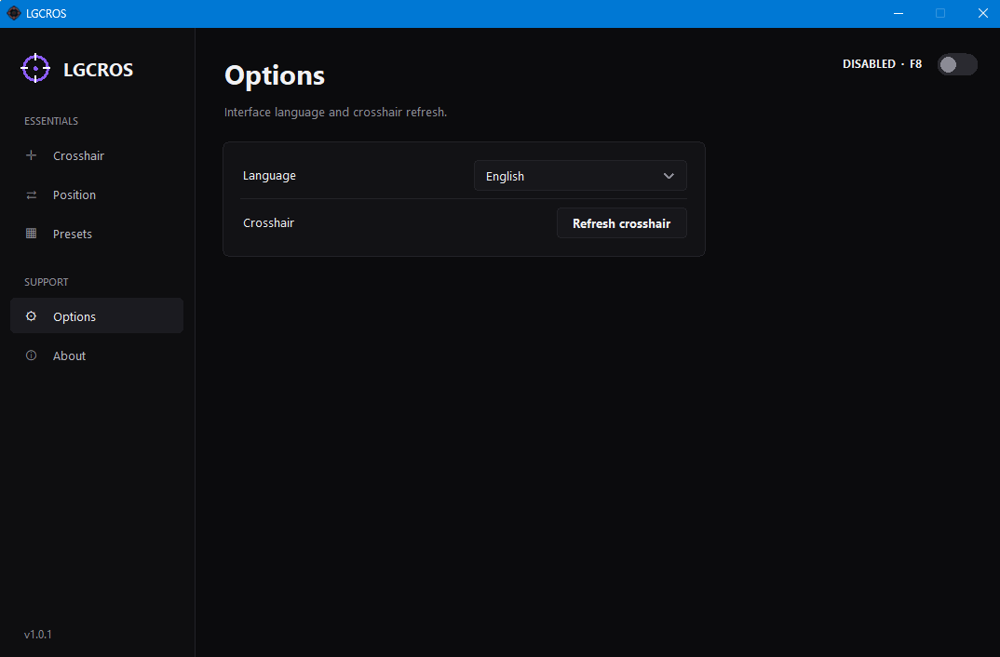
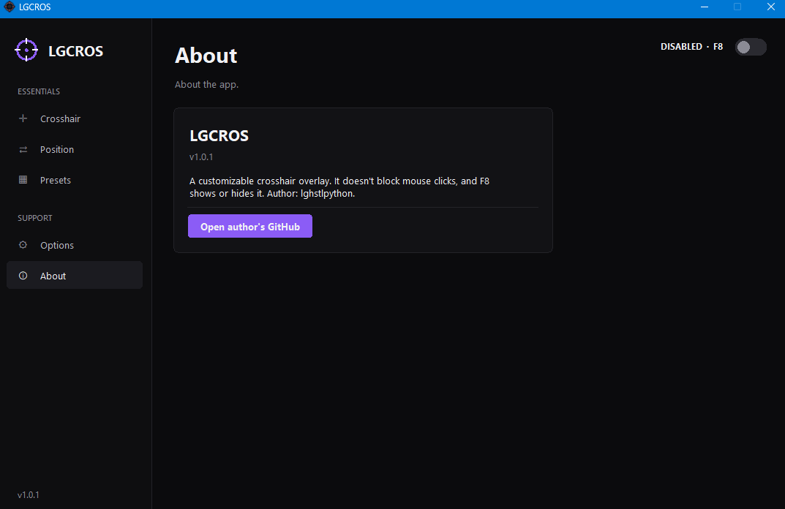

# LGCROS

**LGCROS** is a lightweight, customizable on-screen crosshair overlay for Windows designed to improve aiming precision in shooters.

---

## 📸 Screenshots

| Crosshair | Position | Presets | Options | About |
| :---: | :---: | :---: | :---: | :---: |
|  |  |  |  |  |

---

## ✨ Features

* **Full Customization:** Adjust style, length, thickness, center gap, dot size, color, and outline with live preview.
* **Precision Alignment:** Fine-tune X/Y coordinates in the **Position** tab for any resolution or aspect ratio.
* **Presets & Hotkeys:** Switch profiles or toggle the overlay on/off using the **F8** key.
* **Safe & Lightweight:** Native Windows overlay with zero FPS/input lag impact and zero game file modification.

---

## 💻 System Requirements & Usage

* **OS / Mode:** Windows (Win32), running games in **Borderless Windowed** or **Windowed** mode.
* **Quick Start:** Download `Setup.exe` from [Releases](https://github.com), configure your reticle, press **F8**, and play (works universally in CS2, PUBG, Call of Duty, Apex Legends, Valorant, Rust, etc.).

---

## ⚠️ Disclaimer & License

* **Disclaimer:** Purely a visual accessibility tool; check individual game terms of service before use.
* **License:** Distributed under the MIT License.
